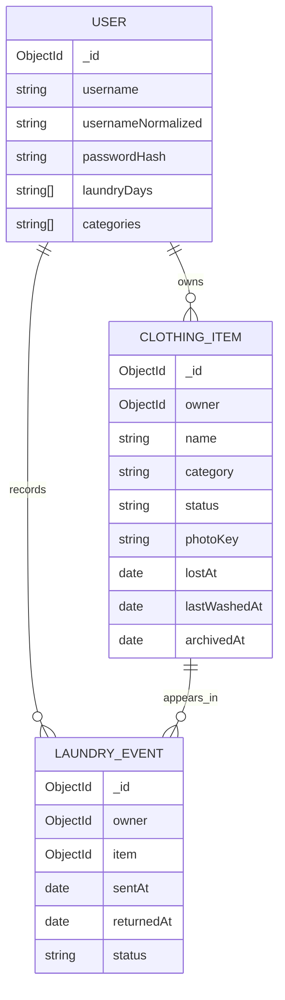

# Database and data model

Washday uses MongoDB through Mongoose. A document is a JSON-like record stored in a collection. Mongoose schemas define the fields the application expects; MongoDB indexes enforce important uniqueness and lookup rules.

## Relationship view



The actual schemas are in `server/src/models/`. The event collection is separate because a clothing item can have many laundry cycles over time. A reference from an event to an item avoids copying names into every history event; the history view populates the current item name and category.

## User document

`User` holds account identity, the bcrypt password hash, selected laundry weekdays, and custom categories. `usernameNormalized` is lowercased for case-insensitive login. `passwordHash` is marked `select: false`, so normal user queries do not return it accidentally. Sign-in explicitly requests it.

The `usernameNormalized` unique index ensures two concurrent account-creation requests cannot claim the same username. Application checks provide a friendly error; the database index is the final authority.

## Clothing item document

`ClothingItem` has an `owner` ObjectId and a small state machine:

```text
available -> in_laundry -> available
available -> missing -> available
in_laundry -> missing
```

`archivedAt` is a soft-delete timestamp. Archiving hides the item from the active closet while retaining its laundry events. An item in laundry cannot be archived, which prevents the return flow from losing its item record.

The compound owner/name/category index uses a case-insensitive collation. A user can have similarly named clothes in different categories, while a duplicate name in the same category is rejected.

## Laundry event document

An event belongs to one owner and one item. Its state changes from `pending` to `returned` or `missing`. `sentAt` and `returnedAt` provide an audit trail that does not depend on the current item status.

The partial unique index on `item` applies only while `status` is `pending`. Completed history rows may repeat an item; only one active laundry event is allowed for it. This protects the invariant even if two web requests race.

## Why updates use transactions

Sending an item writes two collections: create a pending event and change the item's status. Returning it also changes both. Without a transaction, a process crash between writes could leave the event and item disagreeing.

`server/src/utils/transactions.js` wraps both writes in a MongoDB transaction. The same session object is passed to every Mongoose query in the transaction. If a validation, unique-index, or state check fails, MongoDB aborts all writes. A replica set is needed even for a one-node local database; the setup is in `docker-compose.yml` and `scripts/init-mongo-replica.js`.

## Session documents

`connect-mongo` writes login sessions to the `sessions` collection. The browser only receives a signed session identifier in an HTTP-only cookie. Session data itself is not stored in browser local storage.

## Query and index choices

- `User.usernameNormalized`: unique account lookup.
- `ClothingItem(owner, archivedAt, category, name)`: owner-scoped active inventory listing.
- `ClothingItem(owner, name, category)` with case-insensitive collation: duplicate prevention.
- `LaundryEvent(item)` partial unique for pending events: one active cycle per item.
- `LaundryEvent(owner, sentAt desc)`: owner history in newest-first order.

MongoDB aggregation groups clothing counts for the dashboard. Laundry history uses `populate` to read item name/category for display.

## Schema changes and remaining data operations

Mongoose continues to create required indexes at application startup so a missing index cannot silently weaken a running instance. The versioned migration runner records applied steps in `schema_migrations` and is intended for data/schema changes that need operator-controlled ordering. Its initial `001_baseline-indexes` migration records the existing index setup; it does not import the legacy text files or replace the startup index safety check.

Run one `npm run db:migrate` process at a time, after creating the database and before deploying a release with database changes. The runner applies pending migrations in ascending ID order and records each successful migration. Each migration must be safe to retry if a process stops after changing data but before the history record is written. Keep old migration files in source control so a database's history remains explainable. In `NODE_ENV=production`, add `-- --confirm-production` to the command only after taking a provider backup and confirming the target URI; the app configuration must also pass the `DEPLOYMENT_MODE=production` checks when that mode is selected.

Before collecting real user data, rehearse import from a copied sample of the old text-file data and complete the [backup/restore runbook](BACKUP_RESTORE.md). For a multi-instance deployment, move image files from local disk to private object storage and keep database backups outside the application container.
