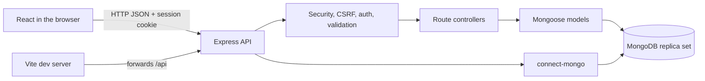

# Washday learning guide

This guide is written to help you explain the code in an interview. Learn the request flow first, then open the files named in each section. You do not need to memorize every line: you should be able to explain the responsibility of each layer and follow one real feature end to end.

## The application in one picture

In development, Vite serves React on port `5173` and forwards `/api` to Express on port `4000`. In a built deployment, Express serves `client/dist` and the API from the same origin. MongoDB holds application records and server-side login sessions.

## Learn it in this order

### 1. Start the project and find the entry points

Read the root `package.json` first. It defines the two npm workspaces and the commands used to start each half. Then read `client/src/main.jsx`, `server/src/server.js`, and `server/src/app.js`.

- `main.jsx` creates the React root and installs browser routing and the account context.
- `server.js` connects to MongoDB before listening for requests and closes the server cleanly on shutdown.
- `app.js` installs Express middleware, routes, static assets, and the final error handler.
- `client/vite.config.js` sends browser API calls to the backend during development.

**Interview check:** Can you explain why the database connection happens before `app.listen`? The API should not accept requests that need database access until the database is available.

### 2. Follow a browser page

Start with `client/src/App.jsx`. React Router decides which page is shown. `ProtectedRoute.jsx` keeps private pages behind the current login state, and `AppShell.jsx` provides the shared navigation.

Then look at the page files:

- `LandingPage.jsx` is public product information.
- `AuthPages.jsx` handles sign-in and account creation.
- `DashboardPage.jsx` displays counts.
- `ClosetPage.jsx` adds, searches, and organizes clothing.
- `LaundryPage.jsx` selects pieces, submits a cycle, and records returns or losses.
- `MissingPage.jsx` lists missing pieces and lets the user mark one found.
- `ProfilePage.jsx` changes laundry days and password.

`components/` contains repeated UI pieces. `styles.css` controls the layout, colors, forms, and responsive behavior. Page components own temporary UI state such as a search value or which checkboxes are selected.

### 3. Understand React state and effects

React state is the page's current data. For example, `ClosetPage` keeps the items, category list, search text, and add-item form in `useState`. When state changes, React renders the affected UI again.

`useEffect` runs side effects such as loading the first list of clothing. `useCallback` keeps a loader function stable when it is used as an effect dependency. `useMemo` derives the visible subset from the full item list without storing a second copy of the same data.

Do not use an effect for every calculation. Search filtering is a calculation from `items`, `search`, and `categoryFilter`, so `useMemo` is a better fit than another effect that updates extra state.

### 4. Trace a request through `api.js`

All React API calls go through `client/src/api.js`. This keeps session cookies, JSON formatting, error parsing, and the CSRF header consistent.

For example, `api.post("/clothes", formData)`:

1. Adds `/api` to the route.
2. Sends the session cookie with `credentials: "include"`.
3. Adds the current CSRF token to `X-CSRF-Token`.
4. Leaves `FormData` alone so the browser can set the multipart boundary for a photo upload.
5. Converts server errors into `ApiError`, which the page displays as a notice.

Open `client/src/context/AuthContext.jsx` next. It loads the current account when the app opens and exposes `signIn`, `signUp`, and `signOut` to pages. The session identifier is an HTTP-only cookie; React never reads it directly.

### 5. Learn the Express pipeline

Open `server/src/app.js`. Middleware runs in registration order:

1. Helmet adds security response headers.
2. `express.json` parses small JSON request bodies.
3. `express-session` reads the cookie and loads its session from MongoDB.
4. `protectAgainstCsrf` rejects unsafe methods without the session token.
5. Route handlers authenticate, validate, read or change data, then send JSON.
6. The final error handler maps known failures to HTTP status codes and hides internal errors from the browser.

`server/src/routes/` maps HTTP methods and paths to controller functions. `server/src/middleware/asyncRoute.js` forwards rejected async work to the error handler. `requireAuthentication` checks that a session has a user ID. Controllers in `server/src/controllers/` implement feature behavior.

**Interview check:** What does `next()` mean in Express? It passes control to the next middleware or to the error handler when passed an error.

### 6. Follow sign-in and account security

Read `AuthPages.jsx`, `AuthContext.jsx`, `api.js`, `csrf.js`, `authRoutes.js`, and `authController.js` in that order.

- `GET /api/auth/csrf` creates a random synchronizer token in the server-side session.
- React sends that token in a custom header on every POST, PATCH, and DELETE request.
- The server compares tokens with `timingSafeEqual` before a state-changing route runs.
- Register and login schemas reject malformed input before it reaches MongoDB.
- `bcryptjs` hashes passwords with a work factor. The original password is not stored.
- On a successful login, `req.session.regenerate` rotates the session ID, which reduces session-fixation risk.
- Sessions are stored in MongoDB through `connect-mongo`, not Express's in-memory development store.
- Login and registration share an IP-based limit backed by `MongoRateLimitStore`, not a per-process memory counter.

`server/src/middleware/mongoRateLimitStore.js` implements the `express-rate-limit` store interface. Each client key maps to one MongoDB document containing the hit count and reset time. The store increments active counters with one atomic update, so separate API instances see the same count. When requests initialize or reset a counter at once, the unique `_id` and bounded retry path resolve the race. Expiration checks use `resetAt`; the TTL index created in `database.js` removes old documents later as storage cleanup. MongoDB's TTL monitor is asynchronous, so it does not decide whether a request is over its limit.

The integration test creates two independent stores with the same prefix, sends concurrent increments, and checks shared counts, decrement/reset behavior, prefix isolation, and a new window after expiry.

The password limit is 72 UTF-8 bytes because bcrypt uses that input limit. The client gives the same guidance. Password hashes are selected explicitly only for sign-in and password change, then are never included in the user JSON response.

### 7. Understand the data model

Read `server/src/models/User.js`, `ClothingItem.js`, and `LaundryEvent.js`, then open [Database and data model](DATABASE.md).

- `User` owns a username, password hash, chosen laundry days, and custom categories.
- `ClothingItem` belongs to one owner and has a status: available, in laundry, or missing.
- `LaundryEvent` belongs to an owner and clothing item and records sent, returned, or missing state.

MongoDB stores references as ObjectIds. Every user-owned query includes the current session's owner ID. That prevents a user from changing a URL ID to access someone else's record.

Indexes enforce rules under concurrent requests. A case-insensitive compound index prevents duplicate clothing names within a user's category. A partial unique index permits at most one `pending` laundry event per clothing item.

### 8. Trace a complete laundry cycle

The most important interview walk-through is the `POST /api/laundry` request:

1. `LaundryPage.jsx` sends selected item IDs.
2. `api.js` includes the session cookie and CSRF token.
3. Express validates CSRF and `requireAuthentication` confirms a session.
4. `sendToLaundry` validates every ID and checks the account's laundry day.
5. `withTransaction` starts a MongoDB transaction.
6. The controller confirms every selected item still belongs to the user and is available.
7. It inserts pending `LaundryEvent` records and changes each item to `in_laundry` in the same transaction.
8. If any record is stale or any write fails, the transaction aborts. Otherwise MongoDB commits both changes together.
9. React reloads the cycle overview and updates the page.

The matching return route changes the item status and its event status in another transaction. This prevents a history event from saying “returned” while the item still says “in laundry.”

Transactions require a MongoDB replica set. Docker Compose starts a local single-node replica set; MongoDB Atlas clusters also support transactions. A plain standalone MongoDB server is not enough.

### 9. Learn photo uploads

The closet form sends `multipart/form-data`. Multer keeps one image in memory and limits it to 5 MB. The controller checks extension, declared MIME type, and file signature before saving it under a random server-generated name. The original filename is never used as a path.

Photos are outside the public static directory. `GET /api/clothes/:itemId/photo` first checks ownership, then sends the private file with `Cache-Control: private, no-store`. Local disk is simple for learning, but a multi-instance production app should use private object storage and a retention/deletion policy.

### 10. Know what still needs work

Before calling this production-ready, add an automated unit/integration suite, run it in CI, rehearse database and legacy-data migrations, document backup/restore, and deploy to a persistent host. Shared laundry-machine booking, time zones, reminders, account recovery, and object storage are future product work. See [Roadmap](ROADMAP.md) and [Security](SECURITY.md).

## Folder map

| Path | Responsibility |
| --- | --- |
| `client/src/main.jsx` | Bootstraps React, router, and login context |
| `client/src/App.jsx` | Maps URLs to public and protected pages |
| `client/src/context/` | Shared browser-side account state |
| `client/src/api.js` | Cookie, CSRF, JSON, and API error handling |
| `client/src/pages/` | Screen-level features and form state |
| `client/src/components/` | Shared layout and UI elements |
| `client/src/styles.css` | Responsive visual system |
| `server/src/server.js` | Connects dependencies and starts the HTTP listener |
| `server/src/app.js` | Express middleware, API, static build, and error handling |
| `server/src/config/` | Environment validation and MongoDB connection |
| `server/src/routes/` | HTTP method/path to controller mapping |
| `server/src/controllers/` | Auth, clothing, laundry, profile, and health behavior |
| `server/src/middleware/` | Authentication, CSRF, async error forwarding |
| `server/src/models/` | Mongoose schemas and database indexes |
| `server/src/services/` | Small reusable domain helpers |
| `server/src/utils/` | HTTP errors and transaction helper |
| `docker-compose.yml` | Local MongoDB replica set process |
| `scripts/init-mongo-replica.js` | Initializes the local replica set once |
| `legacy/` | Historical C and Flask implementations, not used at runtime |

## Exercises to prove you understand it

1. Add an item and follow its ID from React through the route, controller, model, and database.
2. Try sending the same item to laundry twice. Explain the UI check, API state check, and unique-index check.
3. Remove the CSRF header in the browser request and inspect the response.
4. Sign in, inspect browser storage, and explain why JavaScript cannot read the session cookie.
5. Cause a database validation error and follow it to the final Express error handler.
6. Describe what would need to change to host two API instances and store photos in object storage.

Answer keys and question prompts are in [Interview Preparation](INTERVIEW_PREP.md).

## Automated checks

`npm test` runs the fast unit suite. Read `server/tests/input-validation.test.js` to see validation edge cases and `server/tests/security-middleware.test.js` for CSRF and authentication middleware behavior. `npm run test:integration` exercises the real Express API with MongoDB, including session rotation, owner-scoped inventory, and a complete laundry return. It needs the local replica set from the setup steps and only writes to the isolated `laundry_test` database. GitHub Actions runs both suites against MongoDB before building the frontend.
